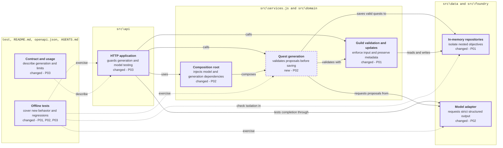

<!-- markdownlint-disable-file -->
# RPI Plan: Issue 2 - AI Quest Master

## Task Metadata

* Task ID: `issue-2`
* Task slug: `issue-2-ai-quest-master`
* Plan date: 2026-11-18
* Resolved plan path: `.copilot-tracking\plans\2026-11-18\issue-2-ai-quest-master-plan.md`

## Executive Summary

Plan a local-only `POST /quests/generate` that tailors a structured model proposal to an adventurer, validates all game rules in the application, and saves only a complete valid quest in the current in-memory store. Preserve existing CRUD request contracts and offline usability.

Planning and full-plan Implementation are complete: quest records and generation rules are protected, structured model orchestration is composed, and protected HTTP generation is documented and validated. The single standard critique completed with a Revise verdict; all five findings are resolved through four direct corrections and the user's pre-save adventurer recheck decision. No second critique was run or required. Review awaits explicit manual advancement.

### What You May Not Know

Objectives require nested defensive copies, and AI provenance must survive existing PUT. The new route shares the existing two-call model budget, so simultaneous generation and model testing compete for those same slots. A deleted or newly underleveled adventurer causes rejection before saving, even after a successful model call. Actual deployed-model structured-output capability remains unverified without a separately authorized billable check.

## Phase Checklist

### After



Key: arrows point from a part to what it uses; dotted arrows, tests and docs; dashed border, new; thick border, changed; tags name the responsible phases.

P01 makes quest validation and repositories safe for generated metadata. P02 composes generation with the current model adapter and saves only validated proposals; P03 calls it through protected HTTP and documents the same contract. This is an additive call path, not a replacement of CRUD; no Before map is needed.

<!-- rpi:phase id=P01 -->
### [x] P01: Preserve quest compatibility and define generation rules

Goals:
* Make generated quest records safe to store and update without changing legacy writable fields.

Dependencies:
* None.

Changes in the map: guild validation and updates, in-memory repositories, offline tests.

<!-- rpi:task id=P01-T01 -->
#### [x] P01-T01: Isolate nested objectives and preserve generated metadata

Goals:
* Stored objectives cannot be changed through caller-owned arrays, and generated provenance survives ordinary quest updates.

Requirements:
* `FR-004`, `FR-005`, `NFR-001`; research F3 and D3.
* Constructor/create/update inputs and list/get/create/update outputs must not expose internal objectives arrays. Existing PUT replaces its old writable fields, preserves `createdAt` and generated-only metadata, and does not upsert.

Details:
* Current records are scalar and copies are shallow. Use the smallest consistent copy mechanism covering supported nested data; avoid a new repository abstraction.
* Manual and seed records do not gain metadata fields. Client attempts to write `objectives` or `aiGenerated` remain invalid on existing POST/PUT.
* Extend current repository tests with array mutation at each boundary, plus generated PUT and unchanged manual/seed behavior.

References:
* [src\data\repository.js](../../../src/data/repository.js): all input/output record boundaries.
* [src\domain\guild-service.js](../../../src/domain/guild-service.js): replacement semantics and timestamp preservation.
* [test\api.test.js](../../../test/api.test.js): existing copy and CRUD regression patterns.
* [.copilot-tracking\research\2026-11-18\issue-2-ai-quest-master-research.md](../../research/2026-11-18/issue-2-ai-quest-master-research.md): research F3, C2, C4, C8, D3.

Dependencies:
* None.

<!-- rpi:task id=P01-T02 -->
#### [x] P01-T02: Define independently enforced generation input and proposal validation

Goals:
* Untrusted request data and model proposals have distinct validation boundaries and explicit game rules.

Requirements:
* `FR-001`, `FR-002`, `FR-003`, `NFR-001`; research F2, F4 and D2.
* The request contract is an object containing exactly the following fields, all required; example values are illustrative:

```json
{ "adventurerId": "adventurer-1", "theme": "forest exploration", "difficulty": "easy" }
```

* The structured model proposal contract requires exactly `title`, `description`, `difficulty`, `minimumLevel`, `goldReward`, `experienceReward`, and `objectives`. It does not accept `id`, `createdAt`, `status`, `aiGenerated` or arbitrary keys.
* Request validation failures use `400 VALIDATION_ERROR`; invalid model proposals use sanitized `502 INVALID_MODEL_RESPONSE`, never a caller-blaming validation error.

Details:
* Extend `validateInput` consistently for request validation and reuse current text/integer/enum primitives where practical. Keep existing schemas unchanged.
* `adventurerId` and `theme` are nonblank strings, at most 200 Unicode code points before trimming. This matches the current bounded short-text convention and does not assume UUID seed IDs.
* Proposal title/description retain 200/5000 code-point limits; require 3-5 nonblank string objectives, each at most 500 code points before trimming. These new field limits are bounded API details, not changes to legacy limits.
* Application validation checks actual JSON shape, exact keys, existing enum, exact requested difficulty, safe integers, user-approved bands and adventurer-relative level bounds. Trim valid strings and each objective only after checking supplied lengths.
* Keep provider JSON Schema separate from application-enforced limits unsupported by the documented provider subset. No schema library or dependency change is required.

References:
* [src\domain\validation.js](../../../src/domain/validation.js): existing validation conventions.
* [src\data\seeds.js](../../../src/data/seeds.js): seed ID format and illustrative balance basis.
* [.copilot-tracking\research\2026-11-18\issue-2-ai-quest-master-research.md](../../research/2026-11-18/issue-2-ai-quest-master-research.md): research F2, F4, W2 and confirmed D2.

Dependencies:
* None.

<!-- rpi:phase id=P02 -->
### [x] P02: Produce and save validated model-generated quests

Goals:
* A composed service tailors generation to an existing adventurer and saves one complete valid quest, or nothing on failure.

Dependencies:
* P01.

Changes in the map: composition root, new quest generation, model adapter, offline tests.

<!-- rpi:task id=P02-T01 -->
#### [x] P02-T01: Support trusted structured-output configuration in the existing model adapter

Goals:
* The same text completion abstraction can request provider-enforced JSON shape without changing ordinary consumers.

Requirements:
* `FR-002`, `FR-007`, `NFR-002`, `NFR-004`; research F1-F2.
* Preserve `complete(input, options)` text return behavior. A trusted internal option must produce `text.format` containing sibling `type: 'json_schema'`, `name`, `schema`, and `strict: true`; callers cannot supply this through HTTP.
* Existing calls without the option must send their existing request shape unchanged.

Details:
* Keep OpenAI and Azure Identity behind the adapter. Use a schema with all fields required, `additionalProperties: false`, basic types/enum and an array item type. Do not copy unsupported numeric/string/array bounds from OpenAPI into the provider schema.
* Preserve lazy configuration, trusted HTTPS endpoint rules, completed/nonempty checks, sanitized classification, independent caller signals, 30-second authentication/inference deadline, no retries and SDK logging off.
* Extend the fake-client and real-SDK-with-mocked-fetch tests to verify exact wire shape and unchanged plain text behavior. Reject incomplete/refused/unusable results safely without weaker-format retry or partial success.

References:
* [src\foundry\model-service.js](../../../src/foundry/model-service.js): adapter and safe SDK configuration.
* [test\foundry.test.js](../../../test/foundry.test.js): mocked SDK and credential tests.
* [package.json](../../../package.json): pinned compatible SDK.
* [.copilot-tracking\research\2026-11-18\issue-2-ai-quest-master-research.md](../../research/2026-11-18/issue-2-ai-quest-master-research.md): research C6, C9, C11-C12, W2.

Dependencies:
* No data-level task prerequisite; follows the P01 phase boundary in the plan's execution order.

<!-- rpi:task id=P02-T02 -->
#### [x] P02-T02: Compose generation, cancellation-safe persistence and safe invocation telemetry

Goals:
* Validated generation uses the selected adventurer, enforces policy outside the model, and reports a safe correlated outcome.

Requirements:
* `FR-001` through `FR-005`, `FR-007`, `FR-008`, `NFR-002` through `NFR-004`; research F1-F5 and D2-D4.
* An unknown adventurer fails with `404 NOT_FOUND` before model invocation; invalid requests likewise make no model call.
* Pass all retrieved adventurer information as delimited task data, together with requested theme/difficulty and game constraints. Untrusted strings are data, not instructions or tool authority.
* Successful creation forces `status: 'open'`, `aiGenerated: true`, server UUID and server timestamp, then saves once to the same quest repository used by CRUD.
* Parse/validation/upstream/cancellation failure must not persist a quest, including a late model resolution after the request signal aborts.
* User-confirmed D5: immediately before saving, re-read the adventurer. If deleted, return `404 NOT_FOUND`; if its current level is below the proposal's minimum, return `409 GENERATION_CONFLICT`; persist nothing. Perform no await between cancellation/eligibility rechecks and the synchronous repository write.

Details:
* Add a small generation consumer under `src\domain`, composed in [src\services.js](../../../src/services.js) using the existing model injection and the same guild/repository instances. A new named service member is acceptable; keep `guild` and `model` usable.
* Retrieve a defensive adventurer snapshot before inference for the prompt and initial proposal checks, then apply the confirmed D5 pre-save recheck. Unrelated name/gold/experience/status edits do not independently invalidate generation. No lock or cross-resource transaction is needed.
* Make one call with a fixed maximum of 4096 output tokens and no automatic retry. Parse exactly one JSON value, with no fence stripping, substring salvage or repair.
* After independent proposal validation, write through the exact quest repository instance shared with `guild.quests`, not the public `GuildService.create` path that rejects generated-only fields. Supply application-owned `createdAt`, `status: 'open'` and `aiGenerated: true`; let `repository.create` assign the UUID. Preserve `GuildService.create` and its manual writable schema. Keep server-managed fields out of model authority.
* Time the actual `model.complete` await separately from later parsing/persistence, retaining the duration even when it throws. Emit one allowlisted invocation-completion event with server-generated correlation ID, model duration, final generation outcome and optional safe code. Invalid output is a failed generation, not a successful one.
* Keep telemetry injectable for offline assertions, defaulting to a safe console sink. A sink exception must not turn a successfully persisted generation into an apparent failure or expose private data.
* Unit tests use fake model dependencies and real fresh in-memory repositories. Cover every invalid-output boundary with table-driven cases and assert no write; no real inference or credential use.

Guidance:
* [src\domain\validation.js](../../../src/domain/validation.js) now exports `validateGeneratedQuest(input, { difficulty, level })` and `generationRewards`; generation request validation uses `validateInput('questGeneration', input)`.

References:
* [src\services.js](../../../src/services.js): composition and model injection.
* [src\domain\guild-service.js](../../../src/domain/guild-service.js): lookup and creation rules.
* [test\api.test.js](../../../test/api.test.js): real repository/test dependency patterns.
* [.copilot-tracking\research\2026-11-18\issue-2-ai-quest-master-research.md](../../research/2026-11-18/issue-2-ai-quest-master-research.md): research F1-F5 and D2-D4.

Dependencies:
* P01-T01, P01-T02, P02-T01.

<!-- rpi:phase id=P03 -->
### [x] P03: Expose protected generation and align tests and documentation

Goals:
* Local clients can generate, retrieve, update and delete AI quests through a documented API while existing behavior remains intact.

Dependencies:
* P02.

Changes in the map: HTTP application, offline tests, contract and usage.

<!-- rpi:task id=P03-T01 -->
#### [x] P03-T01: Add local-only generation with shared execution limits and creation semantics

Goals:
* HTTP generation consistently validates requests, bounds billable execution and returns saved quests through the existing error envelope.

Requirements:
* `FR-001`, `FR-004` through `FR-008`, `NFR-001` through `NFR-004`; research F1, F3, F5 and D3-D4.
* `POST /quests/generate` and its trailing-slash form return `201` with the saved quest and `Location: /quests/{id}`. Other methods return `405` with `Allow: POST` for permitted local callers.
* Apply existing loopback-client and local-Host checks, `application/json`, 64 KiB limit and exact request-field validation before inference.
* Share a per-app maximum of two in-flight model calls across `/model/test` and generation. Saturation returns `429 TOO_MANY_REQUESTS` with `Retry-After: 1`; release slots on every outcome.
* Client disconnect aborts the generation signal. Do not send to a disconnected client or save a result that resolves afterward.

Details:
* Dispatch the literal generation path before generic `/quests/{id}` matching; do not reserve unrelated IDs, alter CRUD filters, or generalize route query validation.
* Create the disconnect signal and correlation ID at the HTTP boundary; pass them as invocation context to the consumer. Domain tests supply a fixed correlation ID and signal. Correlation is logged, with no new public response-header contract.
* Reuse/extract only the minimum shared model-execution guard needed; preserve `/model/test`'s response, input bound, configurable output bound, loopback checks, error mapping and cancellation behavior.
* Reuse existing model-to-HTTP status mapping: configuration 500; model/response rejection and authentication 502; temporary unavailability 503; timeout 504; unexpected exceptions generic 500. D5's pre-save deletion remains `404 NOT_FOUND`; a level conflict uses `409 GENERATION_CONFLICT` in the same safe error envelope.
* Integration tests prove a saved generated quest participates in GET/list/AND filters, existing PUT preservation, and DELETE. Also exercise malformed/invalid HTTP input, missing adventurer, model failure/no save, nonlocal Host rejection, mixed-route concurrency, cancellation/slot recovery and safe correlation/telemetry behavior.

Guidance:
* Call `services.generateQuest(input, { signal, requestId })`; test injection now supports `createServices({ modelService, logGeneration })`.

References:
* [src\api\app.js](../../../src/api/app.js): routing, JSON policy, model guards and error mapping.
* [test\api.test.js](../../../test/api.test.js): isolated HTTP setup, cancellation and concurrency patterns.
* [src\server.js](../../../src/server.js): startup warning may need to name both billable routes.
* [.copilot-tracking\research\2026-11-18\issue-2-ai-quest-master-research.md](../../research/2026-11-18/issue-2-ai-quest-master-research.md): research F1, F5 and D4.

Dependencies:
* P02-T02.

<!-- rpi:task id=P03-T02 -->
#### [x] P03-T02: Synchronize API documentation and prove regression compatibility

Goals:
* Specification, README, repository guide and passing offline checks describe the same implemented contract.

Requirements:
* `FR-009`, `NFR-001` through `NFR-004`; all feature requirements must have matching focused automated evidence.
* OpenAPI describes request/response/error schemas, `201 Location`, local-only checks, 405/Allow, 409 generation conflict, 429/Retry-After, all model failure statuses, field bounds, objective count, read-only metadata and approved game rules, including the pre-save adventurer recheck.
* Do not require `objectives` or `aiGenerated` in legacy writable bodies or alter manual/seed record shape. Generated responses must describe those two fields as present together.
* Run required clean feed installation and `npm test` on Windows; accurately report Node/npm versions, operating system, checks, and any blocker. No live verification command.

Details:
* Keep one clear generated response shape alongside the unchanged legacy write contract. Ensure strict response schemas accept both legacy and generated records without permitting arbitrary keys. Preserve existing non-generation operation definitions.
* README adds a PowerShell generation example with a seeded adventurer and valid requested difficulty, plus response, rules, model prerequisite, billable/local-only warning and shared concurrency explanation. Replace obsolete "does not generate quests" statements.
* Update [AGENTS.md](../../../AGENTS.md) architecture and constraints to include generation without weakening existing guarantees. Update startup warning if needed. No new environment variable or `.env` loading is necessary for the fixed generation budget.
* Existing `node:test` files own HTTP/SDK/storage tests; add at most one domain file, `test\quest-generation.test.js`. The test ownership and coverage lock below is binding.
* Run focused files during implementation, then the required clean feed install and suite once the implementation is coherent. No build/lint/typecheck scripts exist; do not invent them. Stop and report registry or runtime compatibility gaps honestly.

References:
* [openapi.json](../../../openapi.json): public contract and closed record shapes.
* [README.md](../../../README.md): usage, model prerequisites and examples.
* [AGENTS.md](../../../AGENTS.md): contributor architecture and completion rules.
* [.github\copilot-instructions.md](../../../.github/copilot-instructions.md): clean-feed validation and Windows/Linux support.
* [package.json](../../../package.json): real available commands.
* [test\api.test.js](../../../test/api.test.js): OpenAPI reference and API regression checks.

Dependencies:
* P03-T01.

## User Decisions and Requirements

### Confirmed User Direction

* Deliver [issue #2](https://github.com/Master-Oliveira/quest-board-api/issues/2) without breaking the existing Quest API.
* Manual RPI; user explicitly advanced through Planning and subsequently invoked `/hve-core:rpi-implement` to authorize full-plan Implementation.
* Research D2: generation-only seed-inspired gold/XP bands; `1 <= minimumLevel <= adventurer.level`; reject violations without persistence.
* Research D3: generated-only read-only `objectives` and `aiGenerated: true`; preserve through PUT; keep manual request and seed shapes unchanged.
* Research D4: loopback/local-Host restriction, a shared two-call model budget with `/model/test`, and disconnect cancellation.
* Planning D5: re-read the adventurer just before saving; deleted means 404, current level below generated minimum means `409 GENERATION_CONFLICT`, and neither case saves a quest.
* Standard critique and later Review each run once by default. No commits, pushes, issue mutations or live model calls are authorized.

### Planning Decisions and Feedback

Decision participation is `user-owned`, from the manual RPI choice; confirmed research decisions apply without re-questioning. The critique-discovered material choice is resolved:

| Group | Decision or feedback item | Status | Owner | Rationale or input needed | Evidence | Planning impact |
|-------|---------------------------|--------|-------|---------------------------|----------|-----------------|
| D5 | Adventurer state changes during inference | confirmed | user | User chose recheck-before-save: missing returns 404; newly underleveled returns 409 GENERATION_CONFLICT; no save | PC-005; user answer | P02-T02, FR-003/FR-004, HTTP errors/docs and pending-generation regression test |

#### D5: Which adventurer state governs saving?

Resolved: user selected pre-save revalidation. Original alternatives:

* A (recommended): re-read immediately before saving; deleted adventurer returns `404 NOT_FOUND`, or level below the generated minimum returns `409 GENERATION_CONFLICT`; no quest is saved. No await occurs between the recheck and repository write.
* B: use request-start snapshot semantics; the quest may still save after deletion or a level decrease, provided it was valid for the retrieved snapshot.

The proposed recheck reuses existing synchronous storage and does not require transactions. A later name, gold or other unrelated adventurer change does not by itself invalidate generation.

The planner-owned bounded API details in P01-T02 and P02-T02 follow existing text validation and output-budget conventions. They do not change legacy limits, add configuration, or widen scope. The implementer may choose internal symbol/module names and the narrowest reuse mechanism; material behavior changes return for a user decision.

## Planning Readiness and Next Step

| Field | Record |
|-------|--------|
| Planning execution and readiness | Complete; Ready. All five critique findings resolved, including user-owned D5; full-plan Implementation completed and ready for manual Review |
| Decision participation | user-owned; manual RPI, explicit Plan advancement |
| Blockers | none |
| Latest critique | [.copilot-tracking\reviews\plans\2026-11-18\issue-2-ai-quest-master-plan-critique.md](../../reviews/plans/2026-11-18/issue-2-ai-quest-master-plan-critique.md): Complete / Revise |
| Relevant research | [.copilot-tracking\research\2026-11-18\issue-2-ai-quest-master-research.md](../../research/2026-11-18/issue-2-ai-quest-master-research.md) |
| Plan | `.copilot-tracking\plans\2026-11-18\issue-2-ai-quest-master-plan.md` |
| Changes-record role | [.copilot-tracking\changes\2026-11-18\issue-2-ai-quest-master-changes.md](../../changes/2026-11-18/issue-2-ai-quest-master-changes.md) contains completed-task and validation evidence |
| Continuation owner | manual RPI Agent |
| Required gates or confirmations | Planning gates and explicit Implementation advancement passed; no live calls, commits or external mutations authorized |
| Next action | Await explicit `/rpi-review` or implementation refinement; all implementation tasks complete, all 47 tests and required feed install passed on Windows |

## Goals

* Generate useful quest proposals that cannot bypass application game rules.
* Preserve the simple architecture, existing CRUD behavior and offline tests.

## Scope and Non-Goals

### In Scope

* One generation endpoint, generation consumer, trusted structured-output adapter option, nested storage isolation, HTTP execution protections and safe telemetry.
* Focused tests, OpenAPI/README updates, and repository guide updates where architecture changes.

### Non-Goals

* Persistence replacement, authentication framework, deployment, additional model endpoints, dependency upgrades, live inference or committing.

## Functional Requirements

* `FR-001`: Accept exactly `adventurerId`, `theme`, `difficulty`; validate them and resolve the adventurer before model work. Use the adventurer's retrieved details in generation.
* `FR-002`: Request strict structured output containing title, description, difficulty, minimum level, gold, XP and objectives, then independently deserialize and validate it.
* `FR-003`: Enforce exact requested difficulty, 3-5 bounded nonblank objectives, safe-integer rewards inside D2's inclusive bands, and `1 <= minimumLevel <= adventurer.level`; reject invalid proposals. D5 additionally requires the adventurer still exists and meets the generated minimum at the final pre-save check.

| Difficulty | Gold inclusive | XP inclusive |
|------------|----------------|--------------|
| `easy` | 20-30 | 50-75 |
| `medium` | 100-200 | 200-400 |
| `hard` | 500-800 | 900-1400 |
| `legendary` | 3000-5000 | 5000-8000 |

* `FR-004`: Persist exactly one fully valid quest in the existing in-memory repository, with application-owned UUID, timestamp, `status: 'open'`, `aiGenerated: true`, and validated objectives; failure persists nothing.
* `FR-005`: Generated quests participate in all existing Quest API operations and filters. Read-only generated metadata survives PUT; legacy write requirements and manual/seed shapes remain unchanged.
* `FR-006`: Generation is local-only, bounded to a shared two-call model budget, cancellation-aware, and returns standard creation/method/limit semantics.
* `FR-007`: Reuse environment-configured Foundry and existing sanitized model failures without plaintext fallbacks, raw SDK errors or automatic retries.
* `FR-008`: Log server-generated correlation ID, actual model invocation duration and final success/failure outcome without sensitive content.
* `FR-009`: OpenAPI, README and repository guide agree with the new endpoint and preserved legacy contracts; offline unit/integration tests cover acceptance criteria and coupled regressions.

## Non-Functional Requirements

* `NFR-001`: Backward compatibility and data isolation. All existing tests pass unchanged in intent; original CRUD works without model configuration, login or network; deterministic seeds remain; nested arrays cannot mutate stored data.
* `NFR-002`: Bounded safe model execution. Preserve a 30-second authentication/inference deadline and no retries; generation output has a fixed 4096-token maximum; share at most two HTTP-triggered model calls per app; disconnected generation cannot later persist.
* `NFR-003`: Privacy and operational safety. Tests remain offline and credential-free; logs use only allowlisted safe fields; no model output, prompt, adventurer record, credentials, private endpoints or raw SDK errors are logged; no live calls or external exposure authorized.
* `NFR-004`: Local compatibility and validation. Preserve CommonJS, Node.js 22/npm 10 compatibility, pinned dependencies and cross-platform scripts. Required implementation checks are `npm ci --registry=https://packagefeedproxy.microsoft.io/npm/` and `npm test`; report actual OS and results.

## Risks and Open Questions

| Priority | Type | Risk, question, or planning item | Affected work | Impact | Smallest action or evidence needed | Owner |
|----------|------|---------------------------------|---------------|--------|------------------------------------|-------|
| Medium | accepted risk | Configured deployment may not support strict structured output | P02-T01, P03-T02 | Sanitized upstream failure rather than generation | Document prerequisite; do not imply live verification | implementer |
| Medium | accepted risk | The model can produce structurally valid but thematically poor prose | P02-T02 | JSON Schema cannot prove semantic quality | Explicit themed prompt and contextual fake assertions; live quality evaluation deferred | user / implementer |
| Medium | mitigated risk | Adventurer can disappear or level down during inference | P02-T02, P03-T01, P03-T02 | A billable valid proposal may be discarded, never saved for missing/underleveled adventurer | Confirmed D5: synchronous pre-save recheck; test pending-generation delete and level-down | implementer |
| Low | accepted risk | 4096 tokens can still truncate long or reasoning-heavy output | P02-T01, P02-T02 | Error without save, not partial quest | Preserve incomplete-response detection; document capability/limit | implementer |
| Low | tooling limit | Mermaid light/dark rendering not available | plan artifact | Diagram layout not visually verified | Textual map self-check; no claimed preview result | planner |

## Dependencies

* P02-T01 must add structured-output request forwarding to the current adapter. The configured deployment's structured-output capability is unverified and is a runtime prerequisite, not a reason to require live credentials in tests.
* No new package, infrastructure, external service, database, build tool or test runner is planned.

### Test Ownership and Coverage Lock

* Canonical targets: application modules, [openapi.json](../../../openapi.json), [README.md](../../../README.md), [AGENTS.md](../../../AGENTS.md), current tests, and at most one new domain test file `test\quest-generation.test.js`. Generated targets: none. Do not edit installed dependencies/Swagger assets.
* Exact test removals: none. Preserve existing assertions and contracts; only adapt tests if the approved shared model budget requires added coverage, not weakened expectations.
* Maximum additions: 20 top-level test blocks across the suite and at most one new test file. Prefer table-driven subcases for related invalid fields and failures; do not duplicate the same full matrix at unit and HTTP levels.
* Domain owns semantic acceptance coverage: valid personalized proposal, 3/5 objective edges and 2/6 rejection, text/Unicode boundaries, missing/extra/wrong-type fields, malformed JSON, mismatch difficulty, negative/unsafe/out-of-band rewards, adventurer-relative level bounds, application-owned fields and no save for every failure.
* Adapter owns wire/protocol regression coverage: actual SDK `text.format` serialization with mocked token/fetch; unchanged plain completion request; incomplete/refusal/failure behavior; preserve existing deadline/cancellation tests.
* Existing HTTP suite owns representative integration and coupled regressions: pre-model input/404, 201/Location/readback, list/filter/update/delete, read-only metadata, local checks/405/body policy, mixed-route cap/release, disconnect/no-save even after late model completion, safe errors and correlation/allowlisted logging.
* D5 concurrency coverage belongs in a table-driven pending-model test: delete adventurer before resolving the fake model -> 404/no save; lower its level below proposed minimum -> 409/no save; unrelated update -> normal successful creation. Keep within the same 20-block total.
* Repository test cases cover constructor/create/update inputs and every output boundary for mutable objectives. Per-app isolation remains covered.
* Validation evidence must record focused files and final required clean-feed install plus `npm test`, actual Node/npm and Windows version, pass/fail/blocked status, and no live Foundry calls. Linux compatibility is preserved by code/script choices but is not claimed as executed unless actually run there.

## Sources

* [.copilot-tracking\research\2026-11-18\issue-2-ai-quest-master-research.md](../../research/2026-11-18/issue-2-ai-quest-master-research.md): research F1-F5, C1-C13, W1-W2 and confirmed D2-D4.
* [issue #2](https://github.com/Master-Oliveira/quest-board-api/issues/2): authoritative feature request and acceptance criteria; no comments clarify additional behavior.
* [AGENTS.md](../../../AGENTS.md) and [.github\copilot-instructions.md](../../../.github/copilot-instructions.md): architecture, validation, compatibility and safety constraints.
* Business-source discovery: searched workspace filenames for BRD/PRD/ADR candidates and `.adr-config.yml`, and Markdown for `brd_id`, `prd_id`, Quest Master, Quest Generation and Foundry headings. No relevant business sources found; only current README and this task's tracking artifacts matched. No supplied or discovered business source requires status/supersession resolution.
* Planning extensions assessed: no available domain-specific planning extension is necessary for this bounded API feature; reuse Research rather than starting architecture, backlog, security or performance planning workflows.

## Critique Disposition

* Critique setting and provenance: `standard`; first-task parent default.
* Critique status: `Complete`.
* Latest critique and verdict: [.copilot-tracking\reviews\plans\2026-11-18\issue-2-ai-quest-master-plan-critique.md](../../reviews/plans/2026-11-18/issue-2-ai-quest-master-plan-critique.md); `Revise`.
* Earlier critiques: none.
* Limitations: no canvas exposed; Mermaid preview availability not established.

| Critique run and finding | Disposition | Action owner | Exact resolving evidence | Decision route | Plan response or residual risk |
|--------------------------|-------------|--------------|--------------------------|----------------|--------------------------------|
| Initial PC-001 Medium | resolved | planner | P02-T02 Details names the shared quest repository.create, server-owned fields and unchanged public GuildService.create validation | direct correction | Persistence seam clarified without adding a new public write contract |
| Initial PC-002 Medium | resolved | planner | Dependencies explicitly makes adapter forwarding a P02-T01 deliverable and deployment support an unverified runtime prerequisite | direct correction | No current/live capability claim remains |
| Initial PC-003 Medium | resolved | planner | FR-008 and P03-T01/P03-T02 now require log-only correlation, with HTTP-generated context and fixed unit-test context | direct scope reduction | Removed optional public header and its documentation surface |
| Initial PC-004 Low | resolved | planner | P02-T01 Dependencies now observes the P01 phase boundary without inventing a data-level task dependency | direct correction | Sequential phase order is unambiguous |
| Initial PC-005 Medium | resolved | user / planner | User selected recheck-before-save; P02-T02 states synchronous re-read/404/409/no-save, FR-003 and P03 tasks agree, coverage lock names pending-model delete/level-down cases | user-owned behavior decision | Current eligibility is checked without adding locks or persistence |

## Artifact Self-Check

* [x] Executive Summary and change map/checklist precede supporting details.
* [x] Confirmed direction, participation, requirements and scope match the completed research.
* [x] Each phase has Goals, Dependencies and a matching map line; each task has the required five blocks.
* [x] All FR/NFR IDs are cited by tasks; dependencies record actual prerequisites.
* [x] Map has eight parts and four boxes, active arrow labels, supported marks and phase tags; Before omitted for additive-only connections.
* [x] Paths link to existing sources; uncreated artifact paths are not presented as existing.
* [x] Tests have exact ownership, no removals, bounded additions and required validation evidence.
* [x] Standard critique completed and every finding disposed.
* [x] Planning introduced no production changes; Implementation now follows the approved plan. No live calls, credentials or inferred human-signature gate.
* [x] Summary, readiness, D5, error contract and test coverage are synchronized after critique corrections.
* Checked sections: every section, including requirement traceability, task dependencies and link targets.
* Missing or limited sections: diagram rendering not visually checked; actual deployed-model capability unverified; no executable code changed, so application tests/install were not run during Planning on Windows.

## Follow-Up Items

* None.

## Handoff

* Authoritative implementation handoff: Planning Readiness and Next Step.
